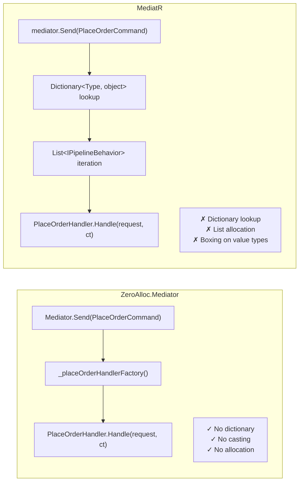

# Performance

ZeroAlloc.Mediator is built for hot paths where mediator overhead would otherwise be measurable. This page explains the four design decisions that eliminate allocation, the benchmark results that validate them, and guidance for when zero-allocation actually matters in practice.

## Why Mediators Usually Allocate

Libraries like MediatR perform several heap operations on every dispatch:

- Maintain a `Dictionary<Type, object>` mapping request types to handler factories
- Build and iterate a `List<IPipelineBehavior<TRequest, TResponse>>` per dispatch
- Box value types when passing through generic interfaces
- Allocate `Task<TResponse>` objects even for synchronous completions
- Use reflection or compiled expressions for handler resolution

Each of these is a heap allocation. Under high throughput (10k+ req/sec), GC pressure builds up. The minor GC pauses that result may be invisible at low load but become measurable — and sometimes dominant — in latency-sensitive or high-throughput workloads.

## How ZeroAlloc.Mediator Eliminates Allocation

Four architectural decisions make zero allocation possible.

### 1. Compile-time dispatch

The Roslyn source generator emits one strongly-typed overload per request type. No dictionary. No casting.

```csharp
// Generated — called directly, zero lookup overhead
public static ValueTask<OrderId> Send(
    PlaceOrderCommand request, CancellationToken ct = default)
    => (_placeOrderHandlerFactory?.Invoke() ?? new PlaceOrderHandler()).Handle(request, ct);
```

Because the overload is resolved at compile time, the call site is a direct method invocation with no runtime type inspection or dictionary lookup.

### 2. Inlined pipeline behaviors

Behaviors become nested static lambda calls, not a list to iterate.

```csharp
// Conceptual generated output with 2 behaviors
public static ValueTask<OrderId> Send(PlaceOrderCommand request, CancellationToken ct = default)
    => LoggingBehavior.Handle(request, ct, (req, token) =>
        ValidationBehavior.Handle(req, token, (req2, token2) =>
            (_placeOrderHandlerFactory?.Invoke() ?? new PlaceOrderHandler()).Handle(req2, token2)));
```

The pipeline is a static call chain baked in at code generation time. There is no `List<IPipelineBehavior>` allocated or iterated at runtime.

### 3. Value type requests

`readonly record struct` means the request data lives on the stack for synchronous call chains. No heap allocation for the request itself.

```csharp
public readonly record struct PlaceOrderCommand(CustomerId CustomerId, ProductId ProductId) : IRequest<OrderId>;
```

Passing a struct through the generated overloads keeps it on the stack. Only async continuations that capture the struct cause a heap allocation — and only when the handler actually suspends.

### 4. ValueTask over Task

`ValueTask<TResponse>` completes without allocating a `Task` object when the handler returns synchronously or via `ValueTask.FromResult(...)`.

```csharp
public ValueTask<OrderId> Handle(PlaceOrderCommand request, CancellationToken ct)
    => ValueTask.FromResult(new OrderId(Guid.NewGuid())); // 0 B allocated
```

For I/O-bound handlers that do suspend, `ValueTask` still reduces overhead compared to `Task` on the fast path.

## Benchmark Results

Measured 2026-10-17 with BenchmarkDotNet on .NET 10, Release build, on an otherwise idle machine. Full benchmark source in `tests/ZeroAlloc.Mediator.Benchmarks/`.

```
BenchmarkDotNet v0.15.8, Windows 11 (10.0.26300.9711)
12th Gen Intel Core i9-12900HK 2.50GHz, 1 CPU, 20 logical and 14 physical cores
.NET SDK 10.0.402
  [Host] : .NET 10.0.13 (10.0.13, 10.0.1326.50504), X64 RyuJIT x86-64-v3
```

> Allocations are exact. Speed is shown as same-run ratios; absolute timings are not published.

Each benchmark ran out of process in three launches, pinned to two performance cores. `MediatR time` is MediatR's mean time divided by ZeroAlloc.Mediator's for the same operation in the same run, with the lowest and highest of the three launches in brackets.

<!-- BENCH:START -->
| Operation | MediatR time | ZA Alloc | MediatR Alloc |
|---|---:|---:|---:|
| Send | **3.89×** (3.54–4.30) | 0 B | 224 B |
| Publish (1 handler) | **16.36×** (15.79–17.43) | 0 B | 792 B |
| Publish (multi handler) | **20.41×** (20.12–20.72) | 0 B | 1,032 B |
| Send + Pipeline | **4.24×** (3.59–4.80) | 0 B | 152 B |
| Send (via IMediator DI, scope per call) | **1.48×** (1.45–1.50) | 176 B | 496 B |
| Send + Pipeline (via IMediator DI, scope per call) | **1.37×** (1.35–1.39) | 176 B | 352 B |
| Publish, 1 handler (via IMediator DI, scope per call) | **2.69×** (2.64–2.78) | 176 B | 992 B |
| Publish, multi handler (via IMediator DI, scope per call) | **3.20×** (3.11–3.34) | 200 B | 1,232 B |
| Stream (5 items) | **2.77×** (2.73–2.83) | 104 B | 528 B |
| Stream (via IMediator DI, scope per call) | **2.25×** (2.21–2.29) | 280 B | 728 B |

The static `Mediator` class is **3.9–20× faster** than MediatR, with zero heap allocations on every non-streaming path. An earlier run reported 160× for `Send`, from a 0.5 ns figure for the static call, too short to measure reliably; the ratio above comes from three pinned launches. `HotPathAllocationTests` and `SpanExceptionDescriptionTests` gate `Send`, `Send` + pipeline and `Publish` at 0 B, and `HotPathAllocationTests` also gates `Send` and `Publish` with no factory registered.

**Handler fallback.** These rows use handlers with a parameterless constructor and no registered factory. The static `Mediator` then reuses one cached instance per handler type, provided the handler is stateless: no instance fields, auto-properties, field-like events or primary-constructor parameters, on the class or on any base class, and no base class from another assembly, whose private fields the generator cannot see. Static fields and constants do not count. The cache is filled on first use and published with `Interlocked.CompareExchange`, so every caller shares one instance; it does not rely on the JIT, so the 0 B holds on .NET 8 and before tier-up too. Before [#328](https://github.com/ZeroAlloc-Net/ZeroAlloc.Mediator/issues/328) the fallback created the handler on every call, 24 B for an empty class, and these rows read 0 B only because the .NET 10 JIT stack-allocated it.

A handler that holds state is still created on every call, so state never leaks from one call into the next; that is one handler object per call. `Mediator.Configure(c => c.SetFactory(() => handler))` is only needed for such stateful handlers, when you want them shared, or 0 B. A registered factory always takes precedence over the cached instance.

**IMediator allocation sources.** The two DI rows create a scope and resolve `IMediator` from it on every call, the way an ASP.NET Core request does, so they include the scope and the transient `MediatorService`. On top of that, `IMediator.Send` with pipeline behaviors can allocate one `next` delegate per behavior per call: its lambdas read the provider it was resolved from, so the compiler cannot cache them (ZeroAlloc.Pipeline#121 tracks removing this). The benchmark's behavior only forwards to `next`, so the .NET 10 JIT inlines it and keeps the delegate on the stack; a behavior that awaits, such as the authorization bridge, pays 64 B per behavior. A pipeline with a behavior that may read `PipelineBehaviorServices.Current` adds 72 B per call for that `AsyncLocal` write; the benchmark's behavior declares `UsesPipelineBehaviorServices = false` and the bridge behaviors take the provider as an argument, so they skip it. See [How a bridge reaches your container](dependency-injection.md#how-a-bridge-reaches-your-container).

**Stream allocation source.** The 104 B on the ZA Stream row is the C# compiler's `async IAsyncEnumerable<T>` state-machine allocation for the user's handler method (e.g. `async IAsyncEnumerable<int> Handle(...) { yield return ...; }`). Any mediator dispatching to such handlers pays this cost — MediatR pays it *on top of* its own ~424 B wrapper. ZA.Mediator's own stream-dispatch contribution is 0 B. .NET 10 has no pooled state-machine builder for `async IAsyncEnumerable<T>` (unlike `ValueTask` with `[AsyncMethodBuilder(typeof(PoolingAsyncValueTaskMethodBuilder))]`); the only way to drop below 104 B is to implement `IAsyncEnumerable<T>` by hand without `yield return`.
<!-- BENCH:END -->

## Dispatch Comparison



## Native AOT

ZeroAlloc.Mediator is fully AOT-compatible. There is no reflection at runtime — all dispatch is statically compiled. To publish as Native AOT:

```xml
<PropertyGroup>
    <PublishAot>true</PublishAot>
    <InvariantGlobalization>true</InvariantGlobalization>
</PropertyGroup>
```

```bash
dotnet publish -r linux-x64 -c Release
```

The generated code uses no `Type.GetType()`, no `Activator.CreateInstance()`, no expression trees, and no dynamic methods — all of which break under AOT. Because the source generator runs at compile time and emits plain C# with no runtime type inspection, the published binary contains only direct method calls.

## When Zero Allocation Matters

**It matters for:**

- Background processing loops handling >10k messages/second
- Low-latency APIs where p99 latency is a hard requirement
- .NET Native AOT deployments where JIT warm-up doesn't exist
- Memory-constrained environments (containers with <256 MB, IoT, embedded .NET)
- High-frequency financial or telemetry pipelines

**It probably doesn't matter for:**

- Standard web APIs handling <1k req/sec (the 100 ns MediatR cost is ~0.0001% of a 100 ms response time)
- Batch jobs that run once a day
- CRUD APIs where the database round-trip dominates latency by 5–6 orders of magnitude

If your profiler or allocation tracker does not show the mediator as a hotspot, the performance characteristics between ZeroAlloc.Mediator and MediatR are irrelevant for your use case. Choose based on API ergonomics or AOT requirements instead.

## Tips for Maximum Performance

1. **Use `readonly record struct` for all request and notification types** — the single highest-impact change. Keeping requests on the stack eliminates the per-request heap allocation entirely on sync paths.

2. **Use `ValueTask.FromResult(value)` in sync handlers** — avoids `Task` allocation. Return `ValueTask<TResponse>` directly rather than wrapping in `Task.FromResult`.

3. **Use static `Mediator.Send` on hot paths** — skip the `IMediator` virtual call when throughput matters. The static overloads are direct calls; the interface dispatch adds one indirection.

4. **Keep pipeline behaviors stateless and `static`** — no instance allocation per request. A `static` behavior method captured in a lambda does not close over any heap object.

5. **Use `[ParallelNotification]` for independent notification handlers** — reduces wall-clock time on multi-handler notifications by dispatching handlers concurrently rather than sequentially. A parallel publish whose handlers all complete synchronously allocates nothing; each handler that is still running, or that failed, costs a `Task`, and together they cost one `Task[]` and the `Task.WhenAll` that awaits them.

6. **Implement `ISpanFormattable` on `[CacheResponse]` requests** — the cache key is `"<request type full name>:<request>"`. A cache hit formats it into a stack buffer and looks it up as a span, on .NET 9 and later with the default `MemoryCache`, so the key string is built only on a miss. The request's own text is the remaining cost: a record formats itself through `ToString`, which allocates on every hit, while a request that implements `ISpanFormattable` writes into the buffer and makes the hit allocation-free. On .NET 8, with another `IMemoryCache`, or for a key over 256 characters, a hit builds the key string.
